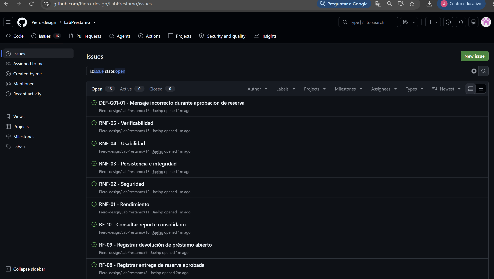
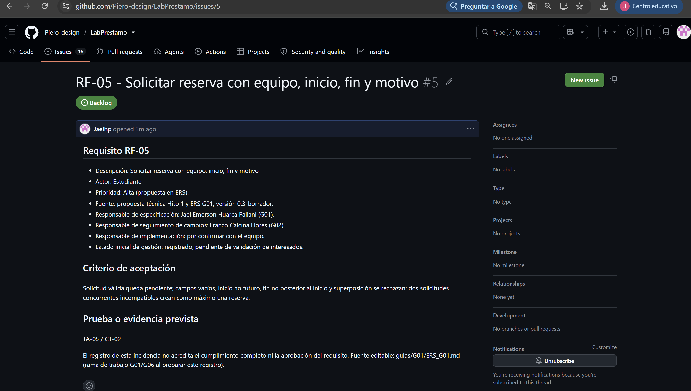

# G01 — Comparación y ficha de herramientas

Proyecto: LabPréstamo. Fecha de registro: 24/11/2026. ERS: 0.3-borrador. Responsable de G01: Jael Emerson Huarca Pallani.

## 1. Objetivo
Seleccionar una herramienta de gestión de requisitos que permita conservar identificadores, responsables, estados, criterios de aceptación y seguimiento de cambios, conforme al enunciado (págs. 2–3).

## 2. Comparación

| Criterio | GitHub Issues | REM (Requirements Management) |
|---|---|---|
| Enfoque | Gestión colaborativa de incidencias y requisitos mediante registros estructurados por el equipo. | Herramienta académica especializada en especificación y gestión de requisitos. |
| Registro | Título, descripción, comentarios, etiquetas y asignatarios; se definió una plantilla con ID, fuente, prioridad y aceptación. | Catálogo de requisitos y documentos de análisis; registros de conflictos, defectos y peticiones de cambio, según la referencia académica consultada. |
| Seguimiento | Historial de actividad, comentarios y enlaces a cambios del repositorio. Los estados detallados de G02 requieren una convención adicional. | Se describe gestión de conflictos y peticiones; no se comprobó el funcionamiento de su historial en una instalación actual. |
| Colaboración | Servicio web compartido; se utilizó el repositorio del equipo. | No se verificó colaboración simultánea en una edición disponible actualmente. |
| Evidencias | Capturas web, enlaces y exportación CSV propia mediante GitHub CLI. | No instalado; formatos y exportación de una versión operativa no verificados. |
| Acceso | Cuenta de GitHub y acceso al repositorio; algunas acciones requieren permisos adicionales. | Descrito históricamente como experimental y gratuito; disponibilidad, versión y licencia actuales no verificadas. |

Se seleccionó GitHub Issues por su integración con el repositorio existente y por la evidencia efectiva de registro. REM se compara documentalmente, no mediante una prueba de instalación. El enunciado permite un gestor de incidencias equivalente. Se recomienda coordinar el flujo con G02 y confirmar la aceptación docente si corresponde.

## 3. Ficha técnica de la herramienta utilizada

| Campo | Detalle |
|---|---|
| Nombre | GitHub Issues y GitHub CLI |
| Versión | Issues: servicio web sin versión local identificable; CLI: 2.103.3, según `gh --version`. |
| Finalidad | Registrar y consultar requisitos y defectos, exportar referencias verificables. |
| Procedencia | GitHub: https://github.com/ ; CLI: https://cli.github.com/ |
| Licencia/acceso | Issues sujeto a los términos de GitHub y permisos del repositorio; GitHub CLI de código abierto con licencia MIT. No se registra ni publica el token. |
| Requisitos | Conexión a Internet, cuenta GitHub, acceso al repositorio con Issues habilitado, PowerShell y GitHub CLI para automatización. |
| Configuración realizada | Repositorio `Piero-design/LabPrestamo`; cuenta autenticada; plantilla de descripción con ID, actor, fuente, prioridad, responsables de especificación y seguimiento, estado inicial, criterio y prueba prevista. |
| Configuración pendiente | Asignatarios nativos, etiquetas, flujo de estados de G02 y responsables concretos de implementación, según acuerdo del equipo. |
| Procedimiento | Verificar `gh --version` y `gh auth status`; ejecutar `Registrar_Requisitos_G01.ps1` desde la raíz del proyecto; consultar Issues y revisar CSV. |
| Archivos | `Registrar_Requisitos_G01.ps1`, `Registro_Requisitos_G01.csv`, figuras 7 y 8 en `Evidencias/`. |

## 4. Resultados
El registro ejecutado el 24/11/2026 produjo 10 RF (#1–#10), 5 RNF (#11–#15) y un defecto (#16), todos abiertos al momento del registro. Se exportó el CSV con sus enlaces. No se atribuye aprobación, verificación completa ni cierre a esos registros. Los responsables constan en las descripciones; la captura de RF-05 muestra que no hay asignatario nativo. La implementación de etiquetas y del flujo de cambios no se declara realizada.

- [Listado de incidencias](https://github.com/Piero-design/LabPrestamo/issues)
- [RF-05](https://github.com/Piero-design/LabPrestamo/issues/5)
- [DEF-G01-01](https://github.com/Piero-design/LabPrestamo/issues/16)

## 5. Referencias
- Enunciado Trabajo Final Calidad de Software, págs. 2–3.
- GitHub Docs: https://docs.github.com/en/issues/tracking-your-work-with-issues/about-issues
- GitHub CLI, listado de incidencias: https://cli.github.com/manual/gh_issue_list
- GitHub CLI, licencia: https://github.com/cli/cli/blob/trunk/LICENSE
- Sánchez Pescador, Elena. Análisis e implantación de una herramienta de gestión de requisitos, apartado 3.5.4 (REM), Universidad Carlos III de Madrid: https://e-archivo.uc3m.es/rest/api/core/bitstreams/1a8f02b2-c9fd-4106-b40f-36a8f84e8626/content
