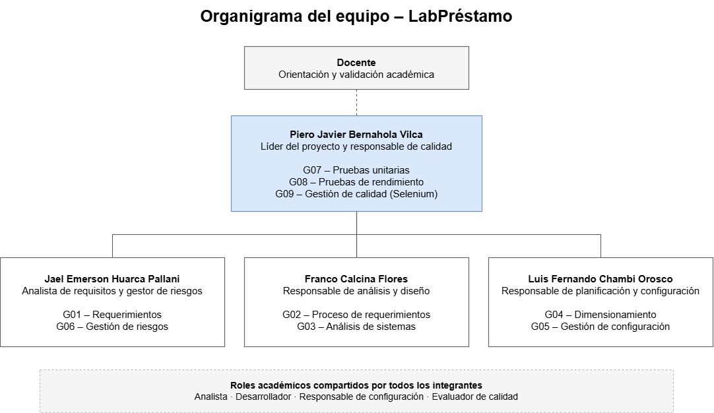

# G01 — Requerimientos de LabPréstamo

**Versión:** 0.3-borrador | **Fecha de elaboración:** 24/11/2026 | **Autor responsable:** Huarca Pallani Jael Emerson | **Estado:** actualizado tras el recorrido local y el registro de incidencias; pendiente de validación de interesados y ratificación de la revisión.

## 1. Objetivo
Elaborar una especificación verificable de los requisitos de LabPréstamo, tomando IEEE 830 como referencia académica de estructura, y establecer una línea base trazable a los procesos, diseño, riesgos y pruebas del producto.

## 2. Propósito, alcance y contexto
LabPréstamo es una aplicación web para gestionar reservas, entrega y devolución de equipos en un laboratorio académico. Busca evitar asignaciones incompatibles, mantener un historial e identificar responsables. El problema de los registros dispersos es una hipótesis de la propuesta inicial, no un hallazgo de campo confirmado. Los procesos principales son solicitud de reserva, aprobación y entrega, y devolución. Se excluyen pagos, multas monetarias, múltiples sedes e integración institucional. Cada reserva corresponde a una unidad física y un intervalo [inicio, fin). Se utilizan cuentas y datos ficticios.

### 2.1 Interesados
| Interesado | Rol o necesidad | Estado |
|---|---|---|
| Encargado del laboratorio | Cliente/representante operativo propuesto; controla equipos, préstamos y devoluciones | Identidad y validación pendientes |
| Estudiante | Consulta disponibilidad y solicita/cancela reservas propias | Representantes pendientes de identificar |
| Docente | Valida alcance y evalúa evidencias académicas | Confirmación de alcance pendiente de documentar |
| Equipo de desarrollo | Implementa, mantiene y verifica requisitos | Cuatro integrantes identificados |

### 2.2 Interfaces, supuestos y restricciones
Interfaz web en navegador, formularios y consultas mediante HTTP; interfaz de persistencia JDBC con H2 en archivo; autenticación y autorización Spring Security. Se requiere Java 17 o superior, Maven y navegador. Se asume un laboratorio y hora local del servidor configurada para America/Lima. No se asume conexión institucional. La propuesta inicial contemplaba PostgreSQL; el README actual declara H2 para simplificar el entorno. Registrar el cambio con G02 y validar su aceptación antes de aprobar la línea base.

## 3. Procedimiento de elicitación
Se prepararon los instrumentos de entrevista y observación en `Elicitacion_G01.md`. El 24/11/2026 se documentó una entrevista simulada individual, sin participante externo, y se ejecutó un recorrido de observación de la aplicación local con cuentas y roles ficticios. No se entrevistó a una persona ni se observó un laboratorio físico. Los resultados y las evidencias se encuentran en [Resultados de elicitación](Resultados_Elicitacion_G01.md). La aceptación de la simulación y la validación con interesados y docente permanecen pendientes.

## 4. Requisitos funcionales
Fuente inicial común: propuesta técnica Hito 1 (10/11/2026), derivada del enunciado y caso orientador. La validación de cada fuente con interesados está pendiente. Prioridad alta para los diez requisitos. Los IDs se conservan para no romper trazabilidad.

| ID | Actor | Descripción | Criterio de aceptación observable | Prueba prevista |
|---|---|---|---|---|
| RF-01 | Estudiante, encargado | Iniciar y cerrar sesión | Credenciales válidas permiten acceder; inválidas se rechazan; después de salir, una ruta protegida deja de ser accesible. | TA-01 |
| RF-02 | Sistema | Restringir operaciones según rol | Un estudiante no puede aprobar, entregar ni devolver, ni por interfaz ni por HTTP directo; un encargado autorizado sí puede ejecutar operaciones válidas. | TA-02 / CT-01 |
| RF-03 | Encargado | Administrar equipos con código único, nombre, categoría y estado | Registro válido persistido, código duplicado rechazado y equipo en mantenimiento no reservable. | TA-03 |
| RF-04 | Estudiante, encargado | Consultar disponibilidad por intervalo | Intervalo válido permite distinguir equipos disponibles de no disponibles; equipo operativo sin superposición ni préstamo vencido abierto aparece disponible. | TA-04 |
| RF-05 | Estudiante | Solicitar reserva con equipo, inicio, fin y motivo | Solicitud válida queda pendiente; campos vacíos, inicio no futuro, fin no posterior al inicio y superposición se rechazan; dos solicitudes concurrentes incompatibles crean como máximo una reserva. | TA-05 / CT-02 |
| RF-06 | Estudiante | Consultar y cancelar solicitudes propias | Solo aparecen las propias; puede cancelar pendiente/aprobada antes del inicio si no se entregó; se rechaza cancelar ajenas. | TA-06 |
| RF-07 | Encargado | Aprobar o rechazar solicitudes pendientes | Registra decisión, responsable y fecha; exige motivo de rechazo y revalida disponibilidad al aprobar. | TA-07 |
| RF-08 | Encargado | Registrar entrega de reserva aprobada | Dentro del intervalo autorizado registra receptor, fecha real y condición inicial; impide doble entrega y refleja el préstamo activo. | TA-08 |
| RF-09 | Encargado | Registrar devolución de préstamo abierto | Registra fecha y condición final, cierra una sola vez y pasa el equipo a mantenimiento si hay daños. | TA-09 |
| RF-10 | Encargado | Consultar reporte consolidado | Filtra por fechas y estado, identifica pendientes y vencidos, totales coinciden con un conjunto conocido de registros. | TA-10 |

Notas de revisión: RF-04 expresa la distinción de disponibilidad del frontend actual; RF-08 incorpora entrega dentro del intervalo y representación del préstamo mediante el estado de la reserva. Confirmar con G02/cliente si estas precisiones constituyen cambios. RF-07 conserva la exigencia de fecha de decisión: el esquema consultado tiene responsable y nota pero no una columna de fecha de decisión; no marcarlo como cumplido sin corregir o aprobar un cambio. RF-08 requiere confirmar si el solicitante asociado es suficiente como receptor; no se identificó un campo separado de receptor. No sustituir un requisito por el comportamiento existente sin autorización.

## 5. Requisitos no funcionales
Fuente: propuesta Hito 1 y umbrales académicos del enunciado; prioridad alta (propuesta). Estado de los resultados: pendiente de medición.

| ID | Atributo | Criterio de aceptación y medición | Evidencia prevista |
|---|---|---|---|
| RNF-01 | Rendimiento | Con 10 usuarios durante 5 min y rampa de 30 s, p95 ≤ 2 s y errores ≤ 1 % por transacción crítica. Documentar entorno y definición de error. | G08 / JMeter |
| RNF-02 | Seguridad | 100 % de los casos definidos sin sesión o de otro rol son rechazados; contraseñas almacenadas con hash adaptativo (BCrypt). | G06/G09, pruebas HTTP y revisión de código |
| RNF-03 | Persistencia e integridad | Tras reiniciar app y base de datos se conservan los 20 registros confirmados de un conjunto de prueba; prueba concurrente no crea doble reserva. | Prueba de reinicio / CT-02 |
| RNF-04 | Usabilidad | Al menos 4 de 5 participantes representativos completan una reserva sin ayuda en máximo 2 min; registrar tiempos, errores y tipo de participante. | Observación de usabilidad |
| RNF-05 | Verificabilidad | Al menos 15 pruebas JUnit reproducibles en 3 componentes de negocio y ≥ 80 % de cobertura de líneas del paquete de negocio con inclusiones y exclusiones documentadas. | G07 / JUnit y JaCoCo |

## 6. Conflictos y decisiones
| ID | Conflicto o discrepancia | Propuesta de resolución | Estado |
|---|---|---|---|
| C-01 | Dos estudiantes solicitan la misma unidad en intervalos incompatibles | Pendientes y aprobadas bloquean; validar y registrar atómicamente; permitir intervalos contiguos | Regla de propuesta; validar con usuario |
| C-02 | Cancelar una reserva después de la entrega impediría conservar trazabilidad | Solo cancelar solicitudes propias pendientes/aprobadas antes del inicio; devolución para cerrar préstamo | Validación pendiente |
| C-03 | PostgreSQL propuesto frente a H2 implementado | Registrar decisión técnica y conservar criterio de persistencia e integridad | Coordinar G02; no afirmar aprobación |
| C-04 | RF-07 exige fecha de decisión no identificada en el esquema actual | Incorporar fecha de decisión o tramitar cambio con impacto en pruebas y diseño | Pendiente |
| C-05 | RF-08 exige receptor y equipo prestado; el modelo conserva solicitante y estado PRESTADO en reserva | Confirmar significado de receptor y representación del estado; corregir si no satisface al usuario | Pendiente |

## 7. Cronograma y roles
Cronograma planificado según Hito 1; no equivale a avance ejecutado.
| Fechas | Actividad |
|---|---|
| 11/11/2026 | Sustentación de propuesta |
| 12–18/11 | Requisitos, diseño, estimación, configuración y riesgos |
| 19–24/11 | Implementación y pruebas |
| 25/11 | Segundo entregable (confirmar alcance con docente) |
| 26/11–01/12 | Correcciones, regresión y consolidación |
| 02/12 | Entrega final y sustentación |

La distribución de guías se confirmó mediante el sorteo del equipo y la asignación adicional de G09 a Piero. Los cargos principales son una propuesta organizativa.

| Integrante | Cargo principal | Guías asignadas |
|---|---|---|
| Piero Javier Bernahola Vilca | Líder del proyecto y responsable de calidad | G07, G08 y G09 |
| Jael Emerson Huarca Pallani | Analista de requisitos y gestor de riesgos | G01 y G06 |
| Franco Calcina Flores | Responsable de análisis y diseño | G02 y G03 |
| Luis Fernando Chambi Orosco | Responsable de planificación y configuración | G04 y G05 |

Cada integrante debe asumir y documentar los cuatro roles académicos: analista, desarrollador, responsable de configuración y evaluador de calidad. Las contribuciones efectivas se registrarán mediante revisiones, commits y pruebas.

Archivos: [Cronograma editable](Cronograma_G01.xlsx), [Organigrama editable](Organigrama_G01.drawio).

## 8. Herramientas y comparación
Se utilizó GitHub Issues con GitHub CLI 2.103.3 para registrar los 15 requisitos y el defecto DEF-G01-01 el 24/11/2026. Se exportaron los enlaces en [Registro_Requisitos_G01.csv](Registro_Requisitos_G01.csv). La comparación documental con REM, la ficha técnica, el procedimiento y las capturas están en [Comparacion_Herramientas_G01.md](Comparacion_Herramientas_G01.md). Los registros se crearon abiertos, pendientes de validación; los responsables constan en la descripción. El flujo de cambios y los asignatarios nativos se coordinarán con G02.

## 9. Lista de revisión
Se preparó la [revisión documental de los 15 requisitos](Revision_Requisitos_G01.md), con criterios de claridad, consistencia, completitud y verificabilidad, además de acciones pendientes. Se identificaron observaciones sobre RF-04, RF-07, RF-08 y RNF-02. La revisión asistida por IA está pendiente de ratificación del responsable y de validación de interesados. No se declara línea base aprobada.

## 10. Resultados, análisis y conclusión
Se ha preparado una especificación preliminar con 15 requisitos y criterios observables. Se dispone de instrumentos, una entrevista simulada y evidencias del recorrido local del 24/11/2026 (versión 0.2.0, revisión Git `5a6840d`). Se observó el flujo principal y se registró DEF-G01-01 durante la aprobación. Permanecen pendientes la validación de interesados, la verificación completa de los criterios de aceptación y la ratificación de la revisión documental. El registro de requisitos en GitHub Issues y su exportación ya se realizaron. Las discrepancias detectadas deben gestionarse con G02, no ocultarse. La ERS proporciona una base de trabajo para las guías de diseño, riesgos y pruebas; solo será línea base aprobada tras la revisión correspondiente.

## 11. Referencias y evidencias
- Trabajo Final Calidad de Software V1, pág. 3 (G01), págs. 2–3 (herramientas), pág. 8 (entrega).
- Informe técnico Hito 1 de LabPréstamo, 10/11/2026, págs. 2–7.
- https://github.com/Piero-design/LabPrestamo (README y esquema consultados el 24/11/2026; revisión local evaluada `5a6840d`).
- https://github.com/Piero-design/LabPrestamo/blob/main/src/main/resources/schema.sql
- Asistencia de IA: borrador y revisión documental; validar y completar con evidencias propias.
