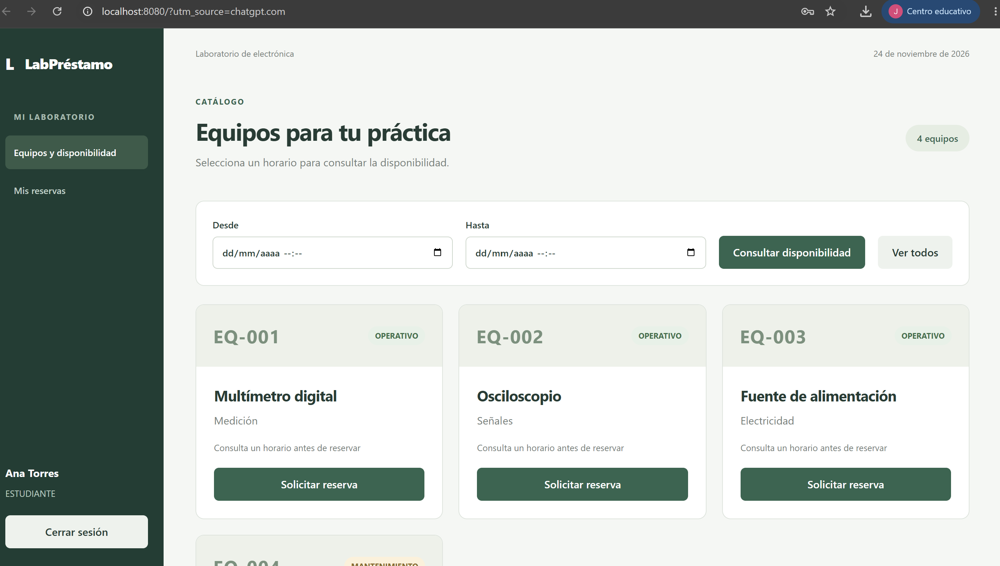
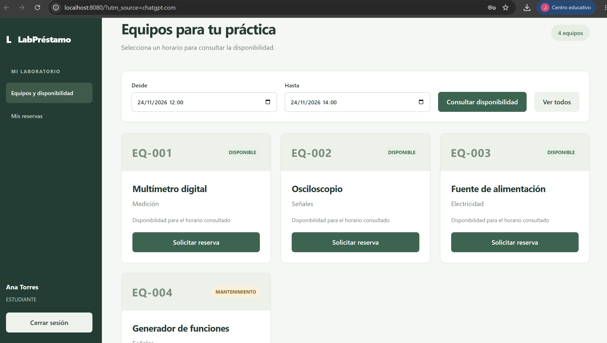
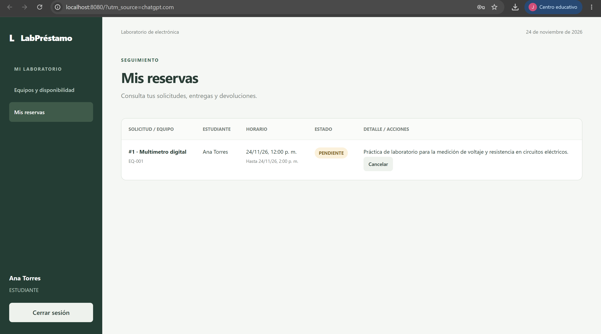
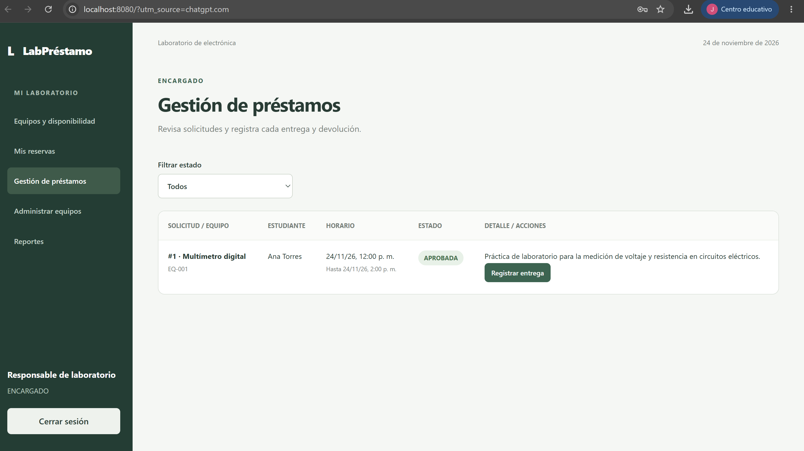
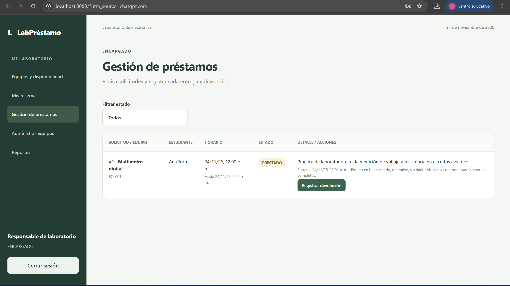
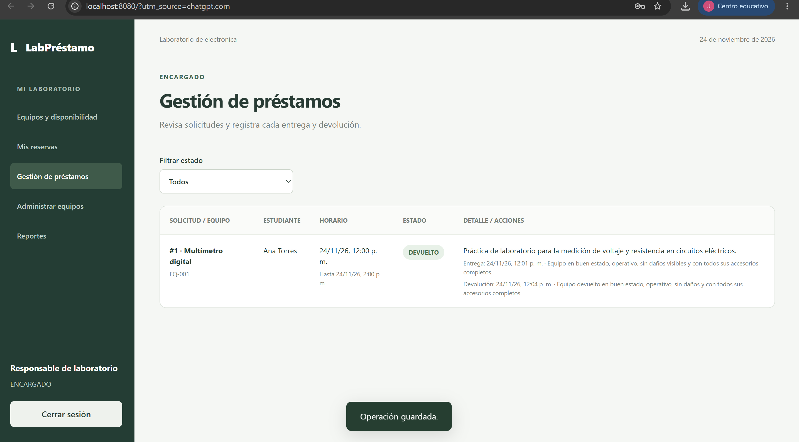
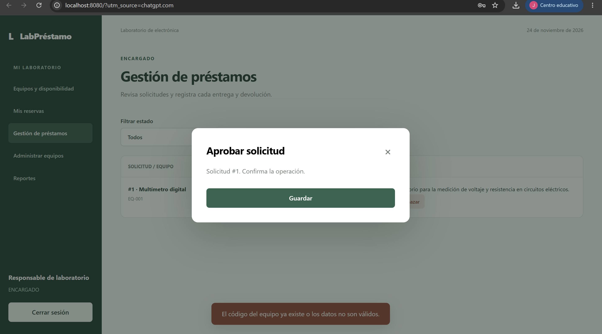

# G01 — Resultados de la simulación de elicitación

- Proyecto: LabPréstamo.
- Fecha de elaboración del escenario: 24/11/2026.
- Fecha de ejecución: 24/11/2026.
- Responsable: Huarca Pallani Jael Emerson.
- ERS de referencia: 0.2-borrador.
- Versión de la aplicación: 0.2.0.
- Revisión Git evaluada: `5a6840d`.
- Modalidad: escenario individual de simulación documental, con roles ficticios de encargado y estudiante.
- Fuente: propuesta técnica del Hito 1 y criterios de aceptación de la ERS G01.
- Estado: entrevista simulada documentada y recorrido individual ejecutado en la aplicación. Revisión formal y validación con interesados y docente pendientes.

No se entrevistó a una persona ni se observó un laboratorio real. Las respuestas de E01 son simuladas, no testimonios ni resultados empíricos. E02 registra observaciones reales de la aplicación local con datos ficticios.

No se atribuyen tiempos medidos, consentimiento o aprobación a terceros. Esta actividad sirve para contrastar las hipótesis de requisitos. Su aceptación como evidencia de elicitación depende del docente.

## 1. E01 — Entrevista semiestructurada simulada

Perspectiva representada: encargado ficticio de un laboratorio académico. Las respuestas son propuestas de comportamiento esperado del sistema.

| N.º | Pregunta | Respuesta simulada | Requisito |
|---|---|---|---|
| 1 | ¿Cómo se registra actualmente una solicitud de préstamo? | En el escenario supuesto se reciben solicitudes de manera manual o por mensajes. Sería conveniente registrar estudiante, equipo, fecha, horario y motivo en una sola aplicación. | RF-05 |
| 2 | ¿Cómo se comprueba la disponibilidad? | Se debe consultar cada equipo físico y comprobar si está operativo y libre en el intervalo solicitado. | RF-03, RF-04 |
| 3 | ¿Quién puede aprobar, rechazar o cancelar una reserva? | El encargado aprueba o rechaza las solicitudes. El estudiante puede cancelar únicamente sus propias reservas antes del inicio, si aún no existe entrega. | RF-02, RF-06, RF-07 |
| 4 | ¿Qué información se necesita al entregar un equipo? | Identificación del equipo y del receptor, reserva aprobada, fecha real de entrega y condición inicial. Solo debe existir una entrega por reserva. | RF-08 |
| 5 | ¿Cómo se registra una devolución y qué ocurre si hay daños? | Se registra la fecha real y la condición final. El préstamo se cierra una sola vez. Si hay daños, el equipo pasa a mantenimiento. | RF-09 |
| 6 | ¿Qué sucede con horarios superpuestos o contiguos? | Las reservas pendientes y aprobadas deben bloquear horarios incompatibles. Si una termina exactamente cuando inicia otra, se permiten intervalos contiguos, siempre que no exista otro impedimento. | RF-04, RF-05, RNF-03 |
| 7 | ¿Qué información deberían mostrar los reportes? | Reservas y préstamos por fecha y estado, pendientes, vencidos y totales consistentes con los registros. | RF-10 |
| 8 | ¿Cómo se gestionan retrasos, cancelaciones y mantenimiento? | Un préstamo vencido y abierto impide nuevas entregas del mismo equipo. Rechazar o cancelar libera el intervalo. Un equipo en mantenimiento no debe ofrecerse para reservar. | RF-03, RF-04, RF-06, RF-08, RF-09 |
| 9 | ¿Qué información debe estar restringida y a quién? | Cada estudiante consulta únicamente sus solicitudes. Las operaciones del encargado deben estar protegidas en el servidor, con autenticación y permisos por rol. Las contraseñas deben almacenarse mediante hash adaptativo. | RF-01, RF-02, RF-06, RNF-02 |
| 10 | ¿Qué tiempo de respuesta y facilidad de uso considera aceptables? | Se adoptan como metas académicas las de la ERS: p95 de hasta 2 segundos y errores de hasta 1 % en la carga esperada; al menos cuatro de cinco participantes completan una reserva sin ayuda en hasta dos minutos. Son metas propuestas, no mediciones ni preferencias de un entrevistado real. | RNF-01, RNF-04 |

## 2. E02 — Recorrido simulado del proceso

Se ejecutó un recorrido individual con cuentas de demostración y roles representados en LabPréstamo, el 24/11/2026. No se observó un laboratorio físico. El objetivo fue contrastar las necesidades identificadas con el funcionamiento de la aplicación web.

### 2.1. Identificación del entorno de ejecución

| Elemento | Descripción |
|---|---|
| Fecha de ejecución | 24/11/2026 |
| Aplicación | LabPréstamo |
| Versión del producto | 0.2.0 |
| Revisión Git | `5a6840d` |
| Rama de trabajo | `docs/g01-g06-requisitos-riesgos` |
| Sistema operativo | Windows 11 de 64 bits |
| Lenguaje | Java 21.0.10 LTS |
| Gestor de dependencias | Apache Maven 3.9.16 |
| Framework | Spring Boot 4.0.3 |
| Base de datos | H2 persistente |
| Navegador | Google Chrome |
| Entorno de ejecución | http://localhost:8080 |
| Modalidad | Ejecución local con datos ficticios |

### 2.2. Datos utilizados

| Campo | Valor |
|---|---|
| Identificador de solicitud | #1 |
| Estudiante | Ana Torres (cuenta ficticia) |
| Encargado | Responsable de laboratorio (cuenta ficticia) |
| Código del equipo | EQ-001 |
| Equipo | Multímetro digital |
| Fecha de reserva | 24/11/2026 |
| Hora de inicio | 12:00 p. m. |
| Hora de finalización | 02:00 p. m. |
| Motivo | Práctica de laboratorio para la medición de voltaje y resistencia en circuitos eléctricos. |
| Hora de entrega registrada | 12:01 p. m. |
| Hora de devolución registrada | 12:04 p. m. |
| Estado final de la solicitud | DEVUELTO |

### 2.3. Registro de observaciones

| Paso | Actor representado | Acción | Resultado observado | Requisito | Evidencia |
|---|---|---|---|---|---|
| 1 | Estudiante | Acceder a la aplicación. | Se visualizó el catálogo de equipos y el rol ESTUDIANTE. | RF-01 | [Figura 1](Evidencias/Figura_01_Acceso_Estudiante.png) |
| 2 | Estudiante | Consultar disponibilidad de 12:00 a 14:00. | EQ-001, EQ-002 y EQ-003 aparecen disponibles; EQ-004 figura en mantenimiento. | RF-04 | [Figura 2](Evidencias/Figura_02_Consulta_Disponibilidad.png) |
| 3 | Estudiante | Solicitar EQ-001 y consultar Mis reservas. | Solicitud #1 guardada como PENDIENTE, con horario y motivo. Se observa la opción Cancelar, aunque no se ejecutó la cancelación. | RF-05, RF-06 | [Figura 3](Evidencias/Figura_03_Solicitud_Reserva.png) |
| 4 | Encargado | Aprobar la solicitud #1. | Se mostró un mensaje incorrecto al guardar. Después de reiniciar la aplicación y acceder nuevamente se observó el estado APROBADA y la opción Registrar entrega. | RF-07 | [Figura 4](Evidencias/Figura_04_Aprobacion_Reserva.png), [Incidencia](Evidencias/Evidencia_Error_Aprobacion_RF07.png) |
| 5 | Encargado | Registrar la entrega indicando la condición inicial. | Estado PRESTADO, entrega a las 12:01 p. m. y condición inicial registrada. Se habilitó la opción Registrar devolución. | RF-08 | [Figura 5](Evidencias/Figura_05_Registro_Entrega.png) |
| 6 | Encargado | Registrar la devolución en buen estado, sin marcar mantenimiento. | Estado DEVUELTO, devolución a las 12:04 p. m., condición final visible y aviso Operación guardada. | RF-09 | [Figura 6](Evidencias/Figura_06_Registro_Devolucion.png) |

No se midió formalmente el tiempo de realización de una reserva. Los horarios registrados de entrega y devolución no acreditan el RNF-04.

La persistencia de esta solicitud tras el reinicio constituye una observación puntual y no sustituye la prueba de persistencia de 20 registros establecida en el RNF-03.

### 2.4. Evidencias del recorrido

#### Figura 1. Acceso al sistema como estudiante

Se observa el acceso al catálogo de equipos mediante una cuenta con rol de estudiante. La interfaz permite consultar equipos y gestionar las solicitudes propias.

**Requisito relacionado:** RF-01.

#### Figura 2. Consulta de disponibilidad de equipos

Se consultó la disponibilidad para el intervalo seleccionado. El sistema mostró tres equipos disponibles y un equipo identificado como en mantenimiento.

**Requisito relacionado:** RF-04.

#### Figura 3. Registro de solicitud de reserva

Se registró una solicitud para el multímetro digital EQ-001. La aplicación conservó los datos ingresados y asignó el estado PENDIENTE.

**Requisitos relacionados:** RF-05 y RF-06.

#### Figura 4. Aprobación de la reserva

Después de reiniciar la aplicación, se comprobó que la solicitud se encontraba en estado APROBADA y que estaba habilitada la opción para registrar la entrega. Durante la operación se identificó un mensaje de error inconsistente, documentado en la sección 2.5.

**Requisito relacionado:** RF-07.

#### Figura 5. Registro de entrega del equipo

El encargado registró la condición inicial del equipo. La solicitud cambió al estado PRESTADO y se mostró la fecha y hora de entrega.

**Requisito relacionado:** RF-08.

#### Figura 6. Registro de devolución del equipo

Se registró la devolución del equipo en buen estado. La solicitud cambió al estado DEVUELTO, conservando la información de entrega y devolución. La aplicación confirmó el registro de la operación.

**Requisito relacionado:** RF-09.

### 2.5. Hallazgo de ejecución DEF-G01-01

Durante el recorrido se identificó una inconsistencia en el mensaje presentado por el sistema al aprobar una reserva.

| Campo | Descripción |
|---|---|
| Identificador | DEF-G01-01 |
| Fecha | 24/11/2026 |
| Requisito relacionado | RF-07 |
| Versión evaluada | 0.2.0 |
| Revisión Git | `5a6840d` |
| Módulo | Gestión de préstamos |
| Usuario | Encargado |
| Datos utilizados | Solicitud #1, equipo EQ-001 |
| Pasos de reproducción | Acceder como encargado, localizar la solicitud pendiente, presionar Aprobar y posteriormente Guardar. |
| Resultado esperado | La reserva cambia al estado APROBADA y se muestra una confirmación coherente con el resultado de la operación. |
| Resultado obtenido | Se mostró el mensaje: El código del equipo ya existe o los datos no son válidos. Después de reiniciar la aplicación y volver a iniciar sesión, la solicitud se encontraba APROBADA. |
| Impacto | El mensaje puede confundir al encargado e inducir reintentos innecesarios. |
| Severidad propuesta | Menor, sujeta a revisión del equipo. |
| Prioridad propuesta | Media. |
| Responsable | Pendiente de asignación por el equipo. |
| Estado | Abierto. |
| Causa raíz | No identificada. |
| Corrección | Pendiente de diagnóstico e implementación. |
| Prueba de cierre | Pendiente de ejecución. |

**Evidencia del hallazgo:**

El hallazgo deberá comunicarse a los responsables de G02 y G09 para su evaluación, incorporación al registro consolidado de defectos y posterior prueba de regresión.

No se declara el defecto corregido únicamente porque la reserva aparezca aprobada después del reinicio.

## 3. Consolidación de hallazgos derivados del escenario

| ID | Origen | Necesidad o conflicto hipotético | Requisitos | Decisión propuesta |
|---|---|---|---|---|
| H-01 | E01-2, E01-6; E02-2, E02-3 | Evitar asignaciones incompatibles sin impedir horarios contiguos. | RF-04, RF-05, RNF-03 | Mantener intervalos [inicio, fin) y proteger la creación concurrente de reservas. |
| H-02 | E01-3, E01-9; E02-1, E02-3, E02-4 | Separar permisos y mantener trazabilidad de decisiones. | RF-01, RF-02, RF-06, RF-07, RNF-02 | Validar permisos en el servidor y conservar responsable y fecha de decisión. |
| H-03 | E01-4, E01-5; E02-5, E02-6 | Evitar duplicidad de entregas y devoluciones y conocer la condición de los equipos. | RF-08, RF-09 | Aplicar transiciones controladas y registrar condiciones inicial y final. |
| H-04 | E01-7, E01-8; E02-2 | Identificar préstamos vencidos y disponibilidad afectada por mantenimiento. | RF-03, RF-04, RF-08, RF-10 | Mantener filtros, reglas de bloqueo y estados coherentes. |
| H-05 | E01-10 | Contar con metas cuantificables de rendimiento y usabilidad. | RNF-01, RNF-04 | Conservar los umbrales académicos y verificar con pruebas reales. |
| H-06 | Revisión de la ERS | Las reglas deben poder probarse de manera reproducible. | RNF-05 | Conservar la meta de 15 casos JUnit sobre tres componentes y 80 % de cobertura de líneas de negocio. |
| H-07 | E02-4 | Presentar mensajes coherentes con el resultado de las operaciones. | RF-07 | Revisar el manejo de excepciones y verificar la corrección del defecto DEF-G01-01. |

## 4. Resultados de la revisión funcional preliminar

| Requisito | Funcionalidad | Resultado observado |
|---|---|---|
| RF-01 | Iniciar y cerrar sesión | Conforme en el escenario de acceso y cambio de usuario. |
| RF-02 | Aplicar permisos por rol | Observación parcial de interfaces diferenciadas. Pendiente verificar restricciones del servidor. |
| RF-03 | Administrar equipos | Pendiente de verificación específica. |
| RF-04 | Consultar disponibilidad | Conforme en el escenario ejecutado. |
| RF-05 | Solicitar una reserva | Conforme para el registro válido observado. |
| RF-06 | Consultar y cancelar solicitudes propias | Consulta observada correctamente. Cancelación y aislamiento de solicitudes pendientes de verificar. |
| RF-07 | Aprobar o rechazar reservas | Aprobación observada con incidencia en el mensaje de confirmación. Rechazo pendiente de verificar. |
| RF-08 | Registrar la entrega | Conforme en el escenario de entrega válida. |
| RF-09 | Registrar la devolución | Conforme en el escenario de devolución sin daños. |
| RF-10 | Consultar reporte consolidado | Pendiente de verificación específica. |

Los resultados corresponden únicamente al escenario ejecutado y no representan la aceptación completa de cada requisito.

Los cinco requisitos no funcionales deberán verificarse mediante las actividades y pruebas correspondientes de las demás guías del proyecto.

## 5. Estado de validación y evidencias

| Actividad | Estado |
|---|---|
| Elaboración del instrumento de entrevista | Completado |
| Documentación de entrevista simulada | Completado |
| Elaboración del instrumento de observación | Completado |
| Ejecución del recorrido en la aplicación | Completado |
| Registro de seis evidencias del recorrido | Completado |
| Identificación de versión y revisión Git | Completado |
| Documentación del defecto DEF-G01-01 | Completado |
| Comunicación del defecto al equipo | Pendiente |
| Revisión formal de los 15 requisitos | Pendiente |
| Validación con interesados y docente | Pendiente |

La entrevista se desarrolló mediante simulación individual y no constituye una entrevista efectivamente realizada a un usuario externo.

No se declara aceptación, consentimiento ni firma de terceros.

## 6. Análisis de resultados

La simulación documental permitió organizar las necesidades propuestas para la gestión de reservas y préstamos de equipos, relacionándolas con los requisitos funcionales y no funcionales de la ERS.

El recorrido realizado sobre LabPréstamo permitió observar los tres procesos principales del sistema: solicitud de reserva, aprobación y entrega, y devolución del equipo.

Durante la ejecución se comprobó la secuencia de estados de la solicitud:

PENDIENTE → APROBADA → PRESTADO → DEVUELTO.

Asimismo, se observó la conservación de los datos de la solicitud, la condición inicial del equipo y la condición final registrada al momento de la devolución.

Se identificó una inconsistencia en el mensaje presentado durante la aprobación, la cual fue documentada como DEF-G01-01. Este hallazgo constituye una oportunidad de mejora relacionada con la comunicación de errores y la experiencia del usuario.

Las observaciones obtenidas permiten contrastar parcialmente los requisitos del sistema, aunque no sustituyen las pruebas funcionales, de seguridad, rendimiento y usabilidad previstas en las demás guías.

## 7. Conclusiones

- La simulación de elicitación permitió organizar y relacionar las necesidades propuestas del estudiante y del encargado con los requisitos de LabPréstamo.
- El recorrido práctico permitió comprobar el funcionamiento del flujo principal de reserva, aprobación, entrega y devolución.
- Se obtuvieron seis evidencias del funcionamiento de la aplicación y una evidencia adicional correspondiente al defecto identificado.
- La identificación de la versión 0.2.0 y la revisión Git `5a6840d` permite relacionar las evidencias con el código evaluado.
- La detección del defecto DEF-G01-01 demuestra la importancia de revisar el comportamiento del sistema durante el proceso de especificación y evaluación de requisitos.
- La especificación continúa sujeta a revisión formal, pruebas complementarias y validación con los interesados y el docente.
