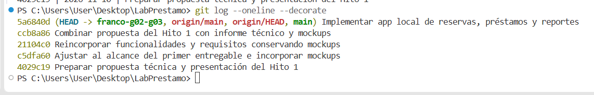
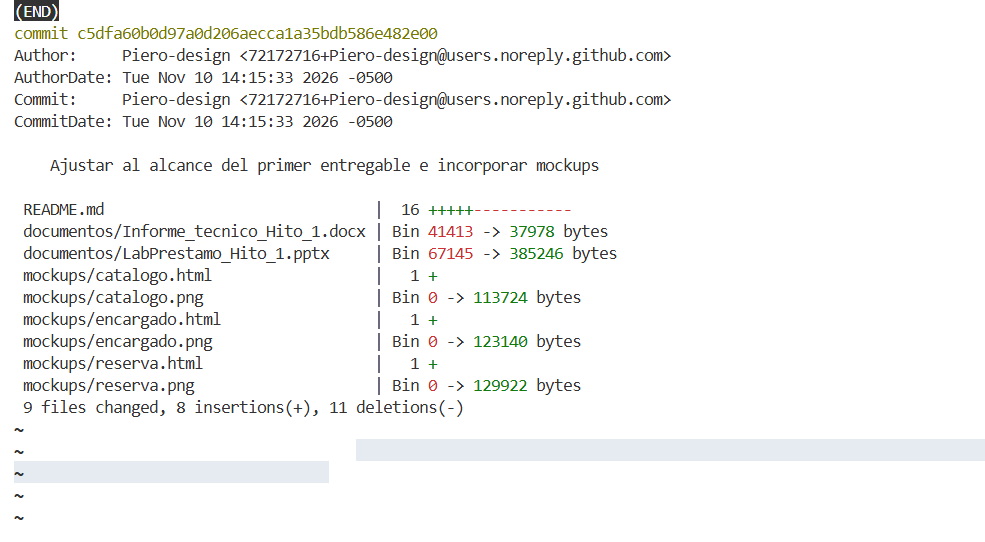
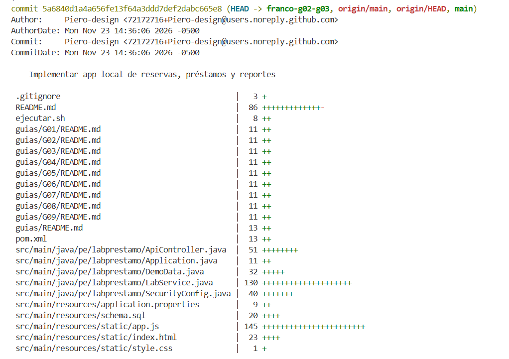

# Informe G02 - Gestión de requerimientos

## Información básica

| Campo | Información |
|---|---|
| Producto | LabPréstamo |
| Integrantes | Jael Emerson Huarca Pallani; Piero Javier Bernahola Vilca; Franco Calcina Flores; Luis Fernando Chambi Orosco |
| Fuentes revisadas | `README.md`, `guias/G02/README.md`, código de `src/`, historial Git y evidencias de esta carpeta |
| Referencia de implementación | Versión 0.2.0, commit `5a6840d` |

## 1. Objeto y alcance

Este informe documenta cinco requerimientos funcionales de LabPréstamo y analiza dos cambios reales registrados en el historial de Git. Los identificadores y reglas se obtuvieron de las funcionalidades descritas en `README.md` y se contrastaron con `src/main/java/`, `src/main/resources/schema.sql` y el frontend de `src/main/resources/static/`.

Los requerimientos se clasificaron según su respaldo técnico. Una descripción coincide con el repositorio cuando existe una ruta, clase, método o restricción que la ejecuta; no se considera una aprobación formal ni una prueba independiente.

## 2. Procedimiento

Se revisó primero la documentación general y la guía G02 para fijar el alcance. Después se consultó el esquema de datos y el flujo implementado en `ApiController.java`, `LabService.java`, `SecurityConfig.java`, `app.js` y `index.html`.

Para el historial se inspeccionaron los commits `c5dfa60` y `5a6840d`, sus fechas y los archivos modificados. Las capturas G02-01 a G02-03 se compararon con la salida de Git para describir lo mostrado sin atribuir aprobaciones no registradas.

## 3. Requisitos verificados

| ID | Descripción | Actor | Precondiciones | Regla o flujo | Criterio de aceptación | Estado | Evidencia técnica |
|---|---|---|---|---|---|---|---|
| RF-04 | Consultar la disponibilidad de equipos para un intervalo. | Estudiante o encargado autenticado | Sesión activa; inicio y fin definidos; el fin debe ser posterior al inicio | `GET /api/equipment?start=...&end=...` obtiene el catálogo y calcula disponibilidad. Un equipo operativo no disponible se excluye cuando una reserva `PENDIENTE`, `APROBADA` o `PRESTADO` se superpone, o cuando existe un préstamo vencido abierto | La respuesta incluye los equipos y el campo calculado de disponibilidad; intervalos sin superposición muestran disponible y los contiguos no se consideran superpuestos | Implementado | `README.md`: consulta de disponibilidad. `LabService.equipment` y `LabService.checkAvailability`; `ApiController.equipment`; `schema.sql`: estados y índice de reserva. `app.js`: `loadEquipment` y `availability`; `index.html`: formulario de disponibilidad |
| RF-05 | Solicitar una reserva indicando equipo, inicio, fin y motivo. | Estudiante según el recorrido documentado; el endpoint exige autenticación, sin restricción explícita a estudiante | Sesión activa; equipo existente y operativo; inicio futuro; fin posterior al inicio; motivo válido de hasta 500 caracteres | `POST /api/reservations` llama a `LabService.reserve`. Se bloquea el equipo mediante `FOR UPDATE`, se valida disponibilidad y se inserta una reserva `PENDIENTE` | El registro queda asociado al usuario autenticado y al equipo, con estado `PENDIENTE`; datos inválidos o conflictos producen 400/404/409 | Implementado | `README.md`: recorrido y RF-05. `ApiController.reserve` y `ReservationInput`; `LabService.reserve`, `required` e `interval`; `LabService.checkAvailability`; `schema.sql`: tabla `reservation`; `app.js`: `reserve` |
| RF-07 | Aprobar o rechazar una solicitud pendiente. | Encargado autenticado | Solicitud `PENDIENTE`; sesión con rol `ENCARGADO`; motivo obligatorio para rechazar | `POST /api/admin/reservations/{id}/{action}` deriva en `LabService.transition`. Aprobar revalida horario, estado del equipo y disponibilidad; rechazar exige motivo. Se guardan estado, `decided_by` y `decision_note` | Una solicitud aprobada queda `APROBADA`; una rechazada queda `RECHAZADA`; no autorizado produce 403 y una solicitud ya atendida o inválida produce 409/400 | Implementado | `README.md`: RF-07 y recorrido. `SecurityConfig.security`; `ApiController.action`; `LabService.transition`; `schema.sql`: campos de decisión y estados; `app.js`: `action` y botones de gestión |
| RF-08 | Registrar la entrega de una reserva aprobada. | Encargado autenticado | Solicitud `APROBADA`; momento dentro del intervalo reservado; equipo operativo; no existe otro préstamo abierto del mismo equipo; condición inicial válida | `POST /api/admin/reservations/{id}/deliver` valida estado y horario, guarda `PRESTADO`, fecha de entrega, responsable y condición inicial | El registro pasa a `PRESTADO` y conserva `delivered_at`, `delivered_by` e `initial_condition`; entrega fuera del horario, equipo no operativo o préstamo abierto produce conflicto o error | Implementado | `README.md`: RF-08 y paso de entrega. `ApiController.action`; `LabService.transition`, caso `deliver`; `schema.sql`: campos de entrega; `app.js`: acción `deliver` |
| RF-09 | Registrar la devolución de un préstamo y el mantenimiento por daño. | Encargado autenticado | Solicitud `PRESTADO`; condición final válida de hasta 500 caracteres | `POST /api/admin/reservations/{id}/return` guarda `DEVUELTO`, fecha y responsable. Si se marca daño, cambia el equipo a `MANTENIMIENTO` | El registro queda `DEVUELTO` con `returned_at`, `returned_by` y `final_condition`; con daño el equipo cambia a `MANTENIMIENTO`; intentar devolver una reserva no prestada produce conflicto | Implementado | `README.md`: RF-09 y recorrido de devolución. `ApiController.action`; `LabService.transition`, caso `return`; `schema.sql`: campos de devolución y estados de equipo; `app.js`: acción `return` |

### Alcance implementado frente a descripción documental

RF-04, RF-05, RF-07, RF-08 y RF-09 tienen rutas, métodos y reglas presentes en el código. El `README.md` confirma estos cinco identificadores y describe su recorrido general.

El detalle de concurrencia y de las reglas de intervalo está implementado en `LabService` y no aparece desarrollado con ese nivel de precisión en la tabla funcional general del README. En cambio, el registro formal de aceptación por actores no está presente en el repositorio. Por ello, los estados de la tabla indican implementación técnica, no aprobación formal ni cierre de validación.

## 4. Cambios reales del historial

### CH-01 — Ajuste del alcance y incorporación de mockups

El commit `c5dfa60`, identificado en la captura G02-02 como “Ajustar al alcance del primer entregable e incorporar mockups”, se realizó el 10 de noviembre de 2026. El diff modifica `README.md`, el informe y la presentación del Hito 1, e incorpora `mockups/catalogo.html`, `mockups/catalogo.png`, `mockups/reserva.html`, `mockups/reserva.png`, `mockups/encargado.html` y `mockups/encargado.png`.

El README anterior describía diez requisitos, cinco no funcionales y un plan de G01 a G09 pendiente de validación. El cambio reduce la descripción a la propuesta del primer entregable y a sus elementos visuales conceptuales. El impacto comprobable es la incorporación de diseños editables y PNG, junto con una presentación y README más centrados en el alcance del primer entregable.

La captura G02-02 muestra el resumen del diff: nueve archivos nuevos o modificados y once eliminaciones. El repositorio no registra una aprobación formal de los interesados ni una entrevista que explique la decisión; por ello, no se atribuye ese motivo.

### CH-02 — Implementación local de reservas, préstamos y reportes

El commit `5a6840d`, mostrado en G02-03, se realizó el 23 de noviembre de 2026 y añadió la aplicación implementada, con 679 líneas positivas y cinco eliminaciones distribuidas en 24 archivos según el resumen registrado por Git.

El diff incorpora Spring Boot, Spring Security, JDBC, H2, el esquema, el API, el frontend y las guías G01 a G09. El motivo de selección de H2 queda respaldado por `README.md`, que indica que se eligió para simplificar la instalación respecto de PostgreSQL, y por el propio diff, que configura `spring.datasource.url` con una base H2 local.

El impacto comprobable es un único proceso de aplicación que persiste datos en `data/labprestamo`, crea tablas desde `schema.sql` y ofrece consultas, reservas, decisiones, entregas, devoluciones y reportes. No existe en el diff ni en la documentación una evidencia de aprobación formal del cambio por el docente o por los usuarios.

## 5. Evidencias

### Historial Git

La captura presenta el registro gráfico de las revisiones y sitúa `5a6840d` como implementación principal. Permite relacionar ambos commits con el estado de la rama.

### Cambio de mockups

La imagen corresponde al commit `c5dfa60` y muestra los archivos de documentación y mockups afectados.

### Cambio de implementación

La imagen corresponde al commit `5a6840d` y muestra la incorporación de código Java, configuración, esquema, frontend y guías.

## 6. Resultados

El análisis identifica cinco requerimientos con reglas respaldadas por código y documentación. Los métodos implementados confirman consulta de disponibilidad, solicitud, decisión, entrega y devolución. También confirman reglas adicionales de concurrencia, estados, permisos, intervalos y mantenimiento.

Los dos cambios históricos están claramente separados: el commit `c5dfa60` incorpora la propuesta visual y ajusta el alcance documental; el commit `5a6840d` incorpora la aplicación funcional y persiste sus datos en H2 local.

Las capturas G02 muestran las acciones del repositorio, pero no acreditan reuniones, pruebas de aceptación, aprobación de interesados ni cierre formal de requisitos.

## 7. Análisis

El trabajo mantiene coherencia entre README, código y esquema para los cinco requerimientos seleccionados. El actor de aprobación y las restricciones administrativas están respaldadas por `SecurityConfig`; las reglas de reserva y entrega están respaldadas por `LabService`; y la persistencia está respaldada por `schema.sql`.

El método usado para reservar permite diferenciar implementación de intención. Por ejemplo, el README indica que el encargado aprueba, rechaza y entrega, mientras el código permite además al usuario autenticado iniciar una reserva desde la ruta común. Esta es una diferencia técnica observable y no se convierte en una modificación aprobada del alcance.

Respecto a los cambios, el README justifica H2 frente a PostgreSQL y el diff confirma la tecnología adoptada. En el caso de los mockups, el diff confirma su incorporación; no demuestra que hayan sido validados por el equipo o sustituidos por una versión posterior.

## 8. Conclusiones

LabPréstamo tiene documentados cinco requerimientos verificables en el estado actual: RF-04, RF-05, RF-07, RF-08 y RF-09. Cada uno cuenta con actor, condiciones, flujo, criterio técnico y evidencia del repositorio.

El commit `c5dfa60` incorporó los mockups y ajustó la documentación del primer entregable. El commit `5a6840d` implementó la aplicación local con H2 y el conjunto de operaciones de reservas y préstamos descritas en el README.

Las decisiones registradas quedan respaldadas solo hasta el alcance del código y la documentación. Ningún elemento probado aquí establece responsabilidad individual, aprobación formal o aceptación de usuarios que no aparezca en el repositorio.
