# Informe G03 - Análisis de sistemas

## Información básica

| Campo | Información |
|---|---|
| Producto | LabPréstamo |
| Integrantes | Jael Emerson Huarca Pallani; Piero Javier Bernahola Vilca; Franco Calcina Flores; Luis Fernando Chambi Orosco |
| Fuentes revisadas | `README.md`, `guias/G03/README.md`, código de `src/`, mockups, diagramas PlantUML y capturas de esta guía |
| Referencia de implementación | Versión 0.2.0, commit `5a6840d` |

## 1. Propósito del SDD

Este documento describe la arquitectura, los componentes, los datos, las interfaces y las reglas de LabPréstamo tal como pueden comprobarse en el repositorio. El sistema es una aplicación web académica para consultar equipos disponibles y gestionar reservas, entrega y devolución.

La versión vigente corresponde a una aplicación de proceso único basada en Spring Boot y JDBC. La propuesta técnica previa sirve como antecedente documental, pero el diseño real se determinó a partir del código implementado.

## 2. Alcance

El alcance implementado incluye autenticación con dos roles, consulta de disponibilidad, solicitud y cancelación de reservas propias, aprobación o rechazo, entrega, devolución, administración de equipos, reporte y exportación CSV.

El sistema utiliza un laboratorio, equipos identificados por código y usuarios registrados. No se implementan entidades de sedes, facturación, multas monetarias, integraciones externas ni notificaciones. Estas ausencias quedan respaldadas por las tres tablas del esquema y por las rutas disponibles en `ApiController`.

## 3. Actores

| Actor | Responsabilidades comprobadas |
|---|---|
| Estudiante | Consultar disponibilidad, solicitar una reserva, consultar sus reservas y cancelar una reserva pendiente o aprobada antes de su inicio |
| Encargado | Consultar disponibilidad y reservas, aprobar o rechazar solicitudes, entregar equipos, recibir devoluciones, administrar equipos y consultar reportes |
| Sistema | Autenticar, aplicar permisos, validar intervalos y estados, bloquear registros, persistir cambios y generar respuestas o exportaciones |

Los roles se obtienen de la tabla `app_user`. El encargado puede utilizar las rutas comunes autenticadas, ya que `SecurityConfig` aplica la restricción administrativa únicamente a `/api/admin/**`.

## 4. Arquitectura

La aplicación sigue una arquitectura por capas dentro de un único proceso Spring Boot:

1. El frontend carga `index.html`, `style.css` y `app.js`.
2. `app.js` obtiene el token CSRF y realiza solicitudes REST a `/api`.
3. `ApiController` recibe parámetros y autenticación, delega operaciones y transforma excepciones de negocio en respuestas HTTP.
4. `LabService` aplica validaciones, operaciones transaccionales y reglas de disponibilidad y transición.
5. `JdbcTemplate` accede a la base H2 definida en `application.properties`.
6. `schema.sql` crea las tablas y restricciones necesarias.

No existe una capa ORM ni un servicio frontend separado. El servidor escucha por defecto en `127.0.0.1:8080` y la base H2 se almacena en `data/labprestamo`.

## 5. Componentes e interfaces

| Componente | Responsabilidad | Interfaces verificadas |
|---|---|---|
| `Application` | Inicia el contexto Spring Boot | Ejecución del método `main` |
| `ApiController` | Expone el API HTTP y obtiene autenticación | `/api/csrf`, `/api/me`, `/api/equipment`, `/api/reservations`, `/api/admin/**` |
| `LabService` | Ejecuta reglas de disponibilidad y transiciones | Métodos `equipment`, `saveEquipment`, `reserve`, `reservations` y `transition` |
| `SecurityConfig` | Carga usuarios y aplica autenticación, sesiones y roles | `/api/login`, `/api/logout` y autorización de rutas |
| Frontend estático | Representa catálogo, reservas, gestión, inventario y reporte | Formularios y acciones implementados en `app.js` |
| H2 / JDBC | Persiste usuarios, equipos y reservas | `JdbcTemplate` sobre `data/labprestamo` |

Las operaciones de escritura envían JSON o datos de formulario junto con el token CSRF. Las respuestas de error contienen un mensaje de negocio para excepciones `ResponseStatusException` y conflictos de integridad.

## 6. Datos

### Modelo persistente

| Tabla | Campos principales | Restricciones comprobadas |
|---|---|---|
| `app_user` | `username`, `password`, `name`, `role` | Usuario único; contraseña no nula; rol `ESTUDIANTE` o `ENCARGADO` |
| `equipment` | `id`, `code`, `name`, `category`, `state` | Código único; estado `OPERATIVO` o `MANTENIMIENTO` |
| `reservation` | Equipo, usuario, inicio, fin, motivo y estado; datos de decisión, entrega y devolución | Equipo y usuario referenciados; fin posterior al inicio; estados definidos |

Una reserva representa tanto la solicitud como el préstamo y la devolución. No existe una tabla ni una entidad Java separada para préstamo.

Los campos `decided_by`, `decision_note`, `delivered_at`, `delivered_by`, `initial_condition`, `returned_at`, `returned_by` y `final_condition` registran las decisiones y movimientos. No existe un campo `decided_at`, por lo que el diseño no debe presentar la fecha de decisión como dato persistido.

## 7. Seguridad

Las contraseñas demo se crean con `BCryptPasswordEncoder`. `SecurityConfig` exige autenticación para las rutas distintas de recursos públicos y restringe `/api/admin/**` al rol `ENCARGADO`.

El login se procesa en `/api/login`, el logout en `/api/logout` y la configuración establece una sesión de 30 minutos y cookie HTTP-only. Las operaciones POST usan el token CSRF obtenido desde `/api/csrf`.

El servidor se enlaza a `127.0.0.1` y el README recomienda usar `America/Lima` para mantener las fechas de acuerdo con el contexto local. Las cuentas de demostración están publicadas en el repositorio y corresponden a uso académico.

## 8. Reglas y decisiones técnicas

### H2 local

La tecnología queda respaldada por `pom.xml`, `application.properties` y `schema.sql`. El README indica que H2 se eligió para simplificar la instalación respecto de PostgreSQL.

### Disponibilidad e intervalos

Las reservas `PENDIENTE`, `APROBADA` y `PRESTADO` ocupan el intervalo. Dos intervalos contiguos no se superponen porque la consulta exige `starts_at < fin` y `ends_at > inicio`.

### Concurrencia

Antes de crear o cambiar una reserva, `LabService` bloquea la fila del equipo con `FOR UPDATE` y realiza las comprobaciones dentro de una transacción. Esto serializa cambios sobre el mismo equipo.

### Entrega y devolución

La entrega exige reserva aprobada, horario vigente y equipo operativo. La devolución exige un préstamo abierto y puede cambiar el equipo a mantenimiento si se reporta daño.

### Horarios

Las validaciones usan `LocalDateTime.now()` y el sistema guarda fechas sin una conversión explícita a UTC.

## 9. Casos de uso detallados

### CU-01 - Solicitar reserva

- **Actor:** estudiante en el recorrido documentado. El endpoint actual solo exige autenticación.
- **Objetivo:** crear una solicitud pendiente para un equipo disponible.
- **Precondiciones:** usuario autenticado; equipo existente y operativo; inicio futuro; fin posterior al inicio; motivo no vacío.
- **Disparador:** seleccionar “Solicitar reserva” en el catálogo.
- **Flujo principal:**
  1. El actor consulta disponibilidad e indica equipo, inicio, fin y motivo.
  2. `app.js` envía `POST /api/reservations`.
  3. `ApiController.reserve` entrega los datos a `LabService.reserve`.
  4. El servicio valida campos e intervalo y bloquea el equipo.
  5. El servicio verifica estado operativo y ausencia de superposición o préstamo vencido abierto.
  6. El servicio inserta la reserva como `PENDIENTE`.
  7. El frontend recarga las reservas y muestra el estado creado.
- **Alternativas y errores:**
  - Inicio o fin inválidos, motivo vacío o inicio no futuro: HTTP 400.
  - Equipo inexistente: HTTP 404.
  - Equipo en mantenimiento, intervalo ocupado o devolución pendiente: HTTP 409.
  - Solicitudes simultáneas: el bloqueo del equipo permite que solo una creación compatible se confirme.
- **Postcondiciones:** existe una reserva pendiente asociada al usuario y al equipo; su intervalo participa en la disponibilidad.
- **Evidencia:** `ApiController.java`, `LabService.reserve`, `LabService.checkAvailability`, `schema.sql` y `app.js`.

### CU-02 - Aprobar o rechazar solicitud

- **Actor:** encargado autenticado.
- **Objetivo:** cambiar una solicitud pendiente a aprobada o rechazada.
- **Precondiciones:** usuario con rol `ENCARGADO`; solicitud existente en estado `PENDIENTE`.
- **Disparador:** seleccionar Aprobar o Rechazar en Gestión de préstamos.
- **Flujo principal:**
  1. `app.js` envía `POST /api/admin/reservations/{id}/{action}`.
  2. `SecurityConfig` verifica el rol encargado.
  3. `LabService.transition` bloquea equipo y reserva.
  4. Al aprobar, verifica que el horario no haya terminado, el equipo esté operativo y no exista conflicto.
  5. Al rechazar, valida un motivo no vacío.
  6. El servicio guarda el estado, el nombre del encargado y la nota.
- **Alternativas y errores:**
  - Usuario sin rol encargado: HTTP 403.
  - Solicitud ya atendida: HTTP 409.
  - Aprobación con horario terminado, equipo en mantenimiento o conflicto: HTTP 409.
  - Rechazo sin motivo válido: HTTP 400.
- **Postcondiciones:** la solicitud queda `APROBADA` o `RECHAZADA`, con responsable y nota. No se persiste fecha de decisión.
- **Evidencia:** `SecurityConfig.java`, `ApiController.action`, `LabService.transition`, `schema.sql` y `app.js`.

### CU-03 - Registrar entrega y devolución

- **Actor:** encargado autenticado.
- **Objetivo:** pasar una reserva aprobada a préstamo y luego registrar su devolución.
- **Precondiciones:** sesión con rol encargado. Para entregar: estado `APROBADA`, momento dentro del intervalo, equipo operativo y sin otro préstamo abierto. Para devolver: estado `PRESTADO`.
- **Disparador:** seleccionar Registrar entrega o Registrar devolución.
- **Flujo principal de entrega:**
  1. El encargado indica la condición inicial.
  2. `app.js` envía la acción `deliver`.
  3. `LabService.transition` verifica estado, horario, equipo y préstamos abiertos.
  4. El registro pasa a `PRESTADO` y guarda fecha, usuario y condición inicial.
- **Flujo principal de devolución:**
  1. El encargado indica la condición final y, si corresponde, marca daño.
  2. `app.js` envía la acción `return`.
  3. El servicio verifica el estado `PRESTADO`.
  4. El registro pasa a `DEVUELTO` y guarda fecha, usuario y condición final.
  5. Si hay daño, el equipo pasa a `MANTENIMIENTO`.
- **Alternativas y errores:**
  - Sin rol encargado: HTTP 403.
  - Estado inválido, entrega fuera de horario o equipo ocupado: HTTP 409.
  - Condición vacía o mayor de 500 caracteres: HTTP 400.
- **Postcondiciones:** el equipo tiene constancia de entrega y devolución; con daño queda en mantenimiento.
- **Evidencia:** `ApiController.action`, `LabService.transition`, `schema.sql` y `app.js`.

## 10. Diagramas UML

Las cuatro imágenes exportadas corresponden a las fuentes editables ubicadas junto a ellas. La revisión comprobó que los elementos principales coinciden con rutas y estados del código.

### Casos de uso

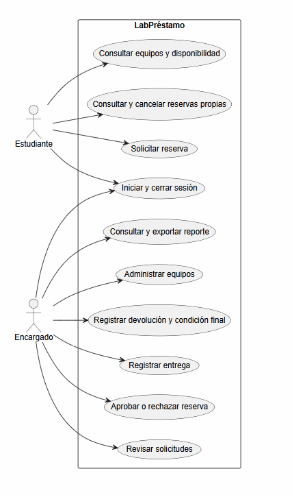

Fuente: [casos_uso.puml](diagramas/casos_uso.puml).

El diagrama representa estudiantes y encargados, solicitud y seguimiento, aprobación, entrega, devolución, administración de equipos y reportes. Coincide con `SecurityConfig` y con las rutas visibles en `ApiController`.

### Actividades

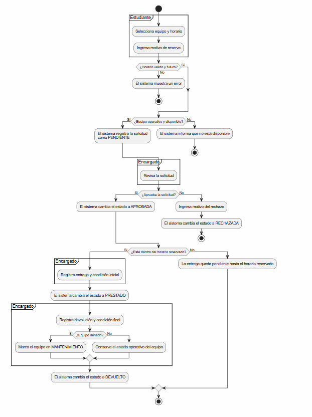

Fuente: [actividades.puml](diagramas/actividades.puml).

El recorrido incluye validación inicial, bloqueo y disponibilidad, decisión del encargado, entrega y devolución. Los caminos de conflicto, rechazo y mantenimiento corresponden a los estados y excepciones de `LabService`.

### Clases y datos

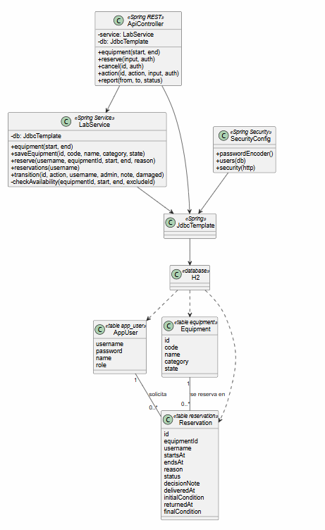

Fuente vigente: [clases.puml](diagramas/clases.puml).

El diagrama muestra `ApiController`, `LabService`, `SecurityConfig`, `JdbcTemplate` y las tablas `app_user`, `equipment` y `reservation`. La nota sobre la ausencia de una entidad Java de préstamo coincide con el esquema actual.

### Secuencia de reserva

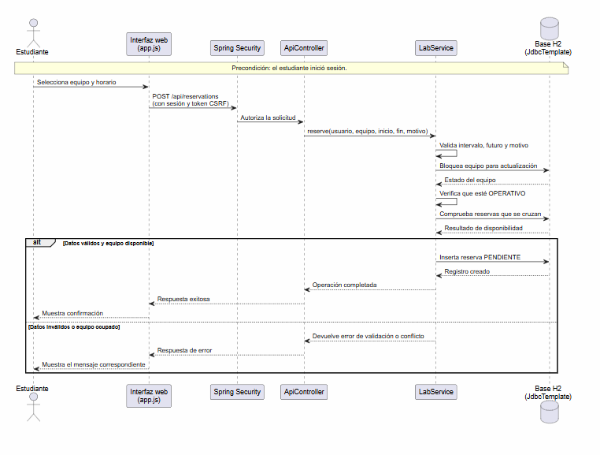

Fuente: [secuencia_reserva.puml](diagramas/secuencia_reserva.puml).

La secuencia continúa desde el frontend hasta el bloqueo del equipo, la comprobación de disponibilidad y la inserción `PENDIENTE`. Los bloques de error representan respuestas 400, 404 y 409 implementadas por el controlador y el servicio.

## 11. Capturas de la aplicación

### Inicio de sesión

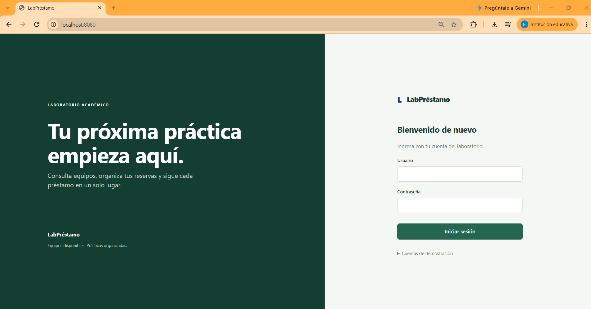

La captura muestra la pantalla de acceso de LabPréstamo y la opción de iniciar sesión.

### Consulta de disponibilidad

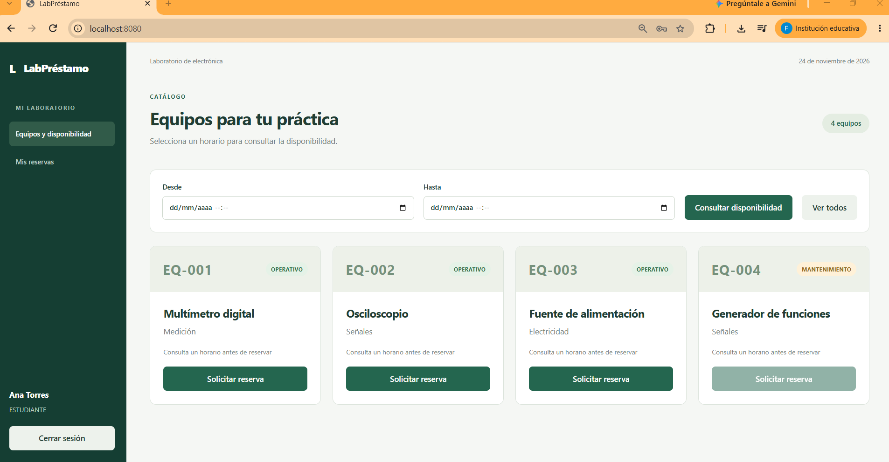

La imagen muestra el catálogo del estudiante, los campos de intervalo y equipos con estados operativo o mantenimiento. También muestra tarjetas de equipos y la acción de solicitar reserva.

### Solicitud de reserva

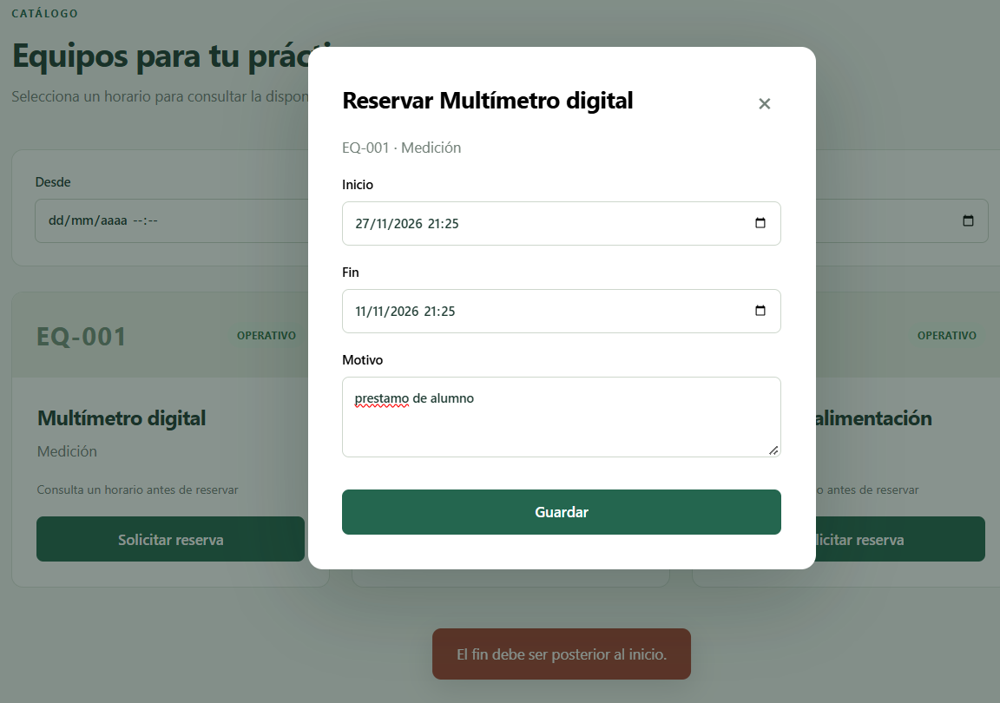

La captura presenta el diálogo de reserva con equipo, inicio, fin y motivo. También incluye una respuesta visible de validación cuando el intervalo no es coherente.

### Gestión de préstamos

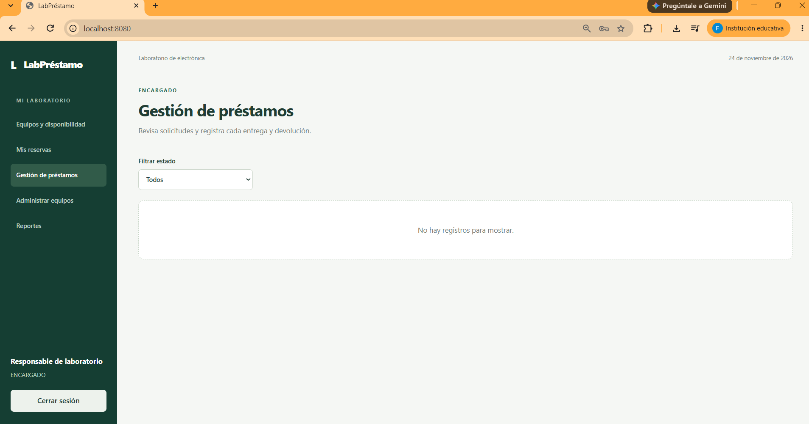

La imagen muestra la sección encargada con filtro de estado y la tabla de solicitudes o préstamos según los registros disponibles.

### Vista posterior de la reserva aprobada

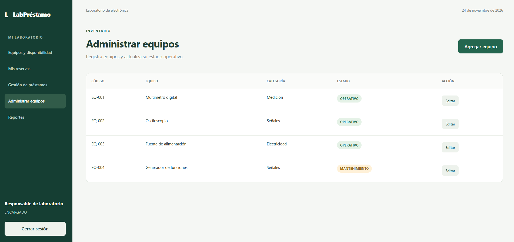

La captura muestra la vista de administración de equipos con código, categoría y estado operativo o mantenimiento. Los botones disponibles permiten editar o agregar equipos.

### Reporte

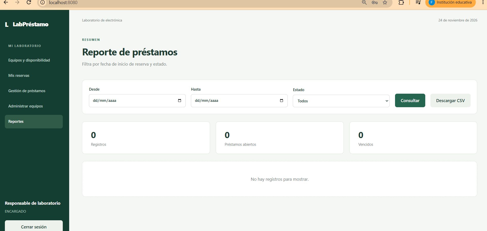

La captura muestra filtros por fecha y estado, los indicadores de registros, préstamos abiertos y vencidos, y el control de descarga CSV.

### Entrega

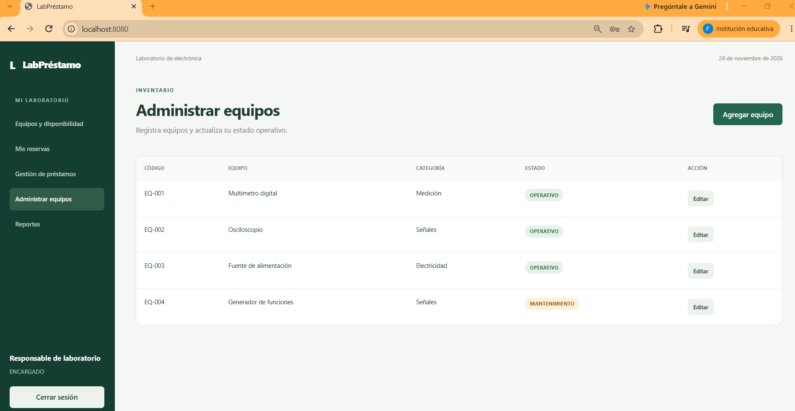

La imagen muestra la interfaz de gestión o inventario utilizada en la evidencia visual de entrega.

### Devolución

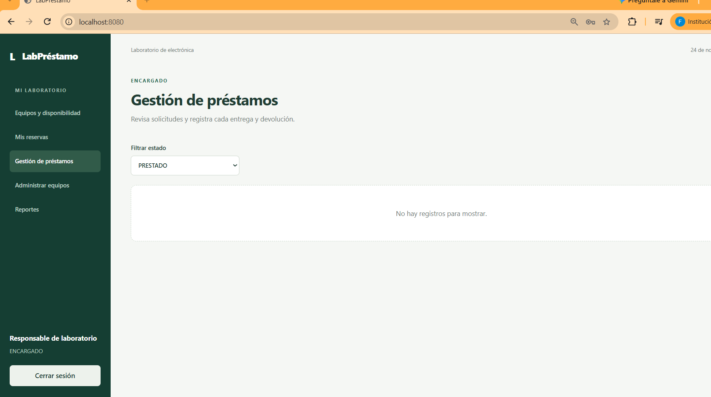

La imagen muestra la interfaz de gestión utilizada para el registro posterior de devolución y mantenimiento.

## 12. Procedimiento

Se contrastaron los cuatro archivos PlantUML con `ApiController`, `LabService`, `SecurityConfig`, `schema.sql` y `app.js`. Las imágenes PNG exportadas se revisaron contra los elementos de cada fuente.

También se compararon los PNG de `mockups/` con las capturas de `evidencias/`. La comparación se limitó a elementos visuales observables y a funciones presentes en el código.

## 13. Resultados

Las fuentes existentes describen el flujo y los componentes implementados. Los nombres vigentes son consistentes con las imágenes: `casos_uso.puml`, `actividades.puml`, `clases.puml` y `secuencia_reserva.puml`.

Las capturas muestran la interfaz de inicio, catálogo, formulario de reserva, administración, reporte y operaciones posteriores. Los archivos disponibles permiten verificar que el frontend implementado mantiene el esquema visual de navegación y contenido de LabPréstamo.

## 14. Comparación entre mockups y aplicación

| Mockup | Coincidencias observables | Diferencias observables |
|---|---|---|
| `catalogo.html` / `catalogo.png` | Barra lateral, título de equipos disponibles, filtros, tabla de equipos y acciones de reserva | El mockup presenta filtros de fecha y horario separados en una tabla horizontal. La aplicación actual usa campos `datetime-local`, tarjetas por equipo y estados calculados de disponibilidad |
| `reserva.html` / `reserva.png` | Selección de equipo, datos de inicio y fin, motivo y estado pendiente | El mockup separa la solicitud y un resumen lateral. La aplicación abre un diálogo sobre el catálogo y muestra el estado durante el seguimiento de reservas |
| `encargado.html` / `encargado.png` | Gestión de solicitudes y préstamos, identificación de solicitante y equipo, acción de devolución | El mockup separa solicitudes pendientes y préstamos en curso en dos paneles. La aplicación usa una tabla única filtrable por estado, con aprobación, rechazo y entrega según el estado de cada registro |

Los archivos conceptuales muestran una estructura estable de navegación y acciones. Las capturas reales muestran tarjetas, tablas filtrables y controles modales propios de la implementación actual. Los archivos no acreditan una actualización oficial de los mockups ni una aprobación de diseño.

## 15. Análisis

Los diagramas se alinean con el comportamiento principal del código. El diagrama de casos muestra las funciones disponibles; el de actividades sigue los estados PENDIENTE, APROBADA, PRESTADO y DEVUELTO; el de clases representa la arquitectura real sin inventar entidades inexistentes; y el de secuencia confirma el bloqueo y la creación transaccional.

Las capturas de aplicación muestran que la interfaz contiene los módulos descritos en el SDD y permite observar diferencia entre la propuesta y la aplicación final. Sin embargo, las imágenes no acreditan por sí mismas pruebas completas ni aceptación de todos los flujos.

## 16. Conclusiones

El SDD describe un sistema implementado con Spring Boot, Spring Security, JDBC y H2 local. Sus actores, componentes, datos, interfaces y reglas pueden verificarse en el repositorio.

Los casos detallados cubren solicitar reserva, aprobar o rechazar una solicitud y registrar entrega y devolución. Las cuatro fuentes PlantUML corresponden a los diagramas exportados y mantienen nombres válidos y coherentes con el código.

Las capturas disponibles muestran los módulos principales de LabPréstamo. La comparación demuestra diferencias de presentación entre los mockups conceptuales y la aplicación actual, sin atribuir una actualización aprobada de los diseños.
